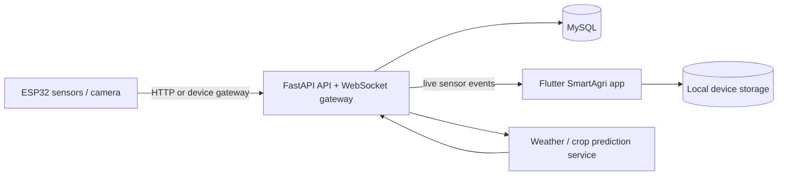
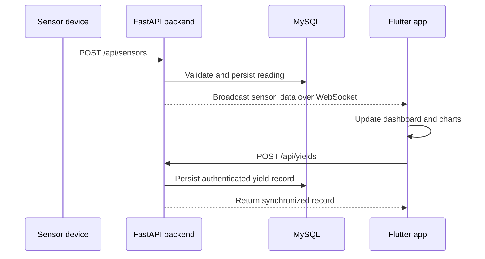
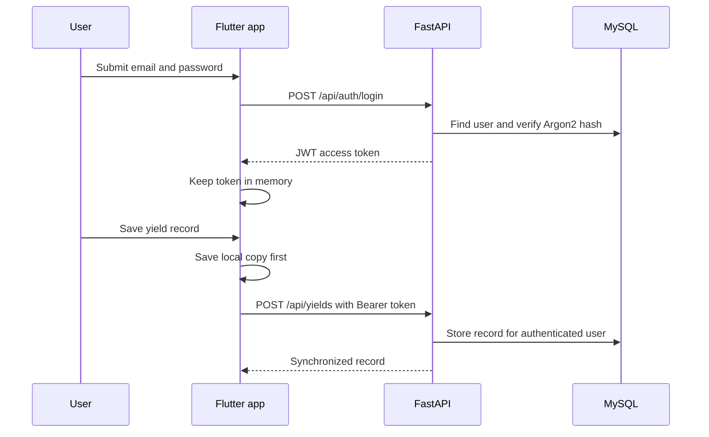
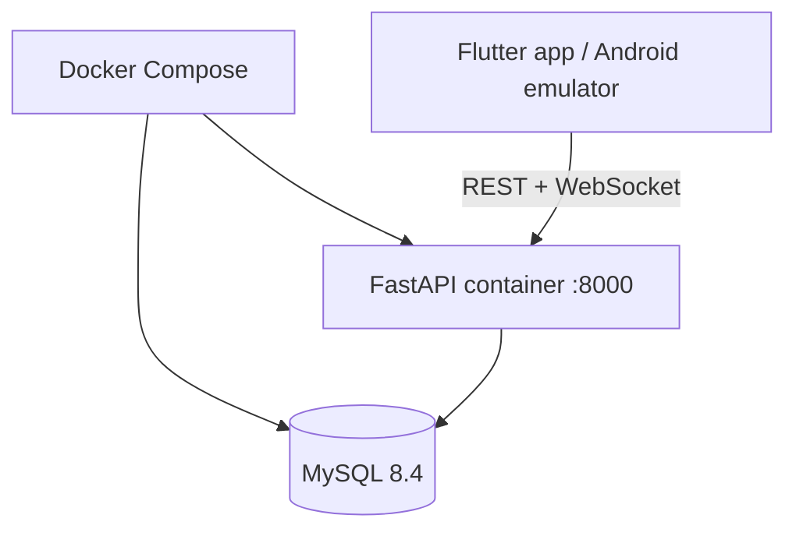

# SmartAgri

[](https://flutter.dev/)
[](https://fastapi.tiangolo.com/)
[](https://www.mysql.com/)
[](https://docs.docker.com/compose/)
[](#license)

SmartAgri is a full-stack agricultural monitoring platform that combines a
Flutter mobile dashboard with a FastAPI/MySQL backend. It is designed to make
farm sensor data, camera observations, crop recommendations, and yield records
available in one accessible workflow.

> **Status:** portfolio-ready full-stack prototype. The core client, API,
> authentication, persistence, WebSocket broadcasting, and local Docker setup
> are implemented. Production hardening items are listed in
> [Roadmap](#roadmap).

## Contents

- [What it does](#what-it-does)
- [Architecture](#architecture)
- [Repository layout](#repository-layout)
- [Quickstart](#quickstart)
- [API](#api)
- [Security and configuration](#security-and-configuration)
- [Testing](#testing)
- [Roadmap](#roadmap)
- [Resume summary](#resume-summary)
- [License](#license)

## What it does

- Displays live temperature, humidity, light, and soil-moisture readings.
- Receives sensor and camera updates over WebSockets.
- Shows camera images, rain probability, weather context, and crop forecasts.
- Presents rolling sensor charts and yield comparisons.
- Supports farmer registration and JWT-based sign-in.
- Saves yield records locally first and synchronizes them with the backend.
- Provides Tamil/English text-to-speech accessibility support.
- Persists users, sensor readings, and synchronized yield records in MySQL.

## Architecture



### Runtime data flow



### Authentication and yield synchronization



### Local deployment



## Repository layout

```text
.
├── backend/
│   ├── app/
│   │   ├── config.py       # environment-backed settings
│   │   ├── database.py     # async SQLAlchemy engine/session
│   │   ├── main.py         # REST and WebSocket routes
│   │   ├── models.py       # MySQL entities
│   │   ├── schemas.py      # validated API contracts
│   │   └── security.py     # password hashing and JWTs
│   └── tests/
├── flutter_application_2/
│   ├── lib/
│   │   ├── models/
│   │   ├── providers/
│   │   ├── screens/
│   │   ├── services/
│   │   └── widgets/
│   └── test/
├── .env.example
├── backend/.env.example
├── docker-compose.yml
└── README.md
```

`flutter_application_2` is the canonical client. The old `cas/` and
`flutter_application_1/` experiments are intentionally excluded from the
uploadable project.

## Quickstart

### Prerequisites

- Flutter SDK
- Python 3.12+
- Docker Desktop
- Git

### Configure secrets

Copy the safe template; never commit the resulting file:

```powershell
Copy-Item .env.example .env
```

Generate a signing secret:

```powershell
python -c "import secrets; print(secrets.token_urlsafe(48))"
```

Put the generated value in `JWT_SECRET` inside `.env`. Replace all database
placeholders as well.

### Start MySQL and the backend

```powershell
docker compose up --build
```

The API is available at `http://localhost:8000`.

Verify health:

```powershell
Invoke-RestMethod http://localhost:8000/health
```

Expected response:

```json
{"status":"ok"}
```

### Run the Flutter client

From `flutter_application_2/`:

```powershell
flutter pub get
flutter run `
  --dart-define=SMARTAGRI_BACKEND_HOST=10.0.2.2 `
  --dart-define=SMARTAGRI_BACKEND_PORT=8000
```

`10.0.2.2` is the Android emulator alias for the host machine. For a physical
device, use the host computer's LAN address instead.

## API

| Method | Endpoint | Purpose | Auth |
|---|---|---|---|
| `GET` | `/health` | Service health check | No |
| `POST` | `/api/auth/register` | Create a farmer account | No |
| `POST` | `/api/auth/login` | Issue a JWT | No |
| `GET` | `/api/auth/me` | Read current user | Bearer JWT |
| `GET` | `/api/yields` | List the current user's records | Bearer JWT |
| `POST` | `/api/yields` | Create a yield record | Bearer JWT |
| `POST` | `/api/sensors` | Validate and ingest a sensor reading | Device auth planned |
| `WS` | `/ws` | Receive live sensor broadcasts | Device/app auth planned |

Interactive API documentation is available at
`http://localhost:8000/docs` when the backend is running.

## Security and configuration

- Database credentials are loaded from `.env` only.
- JWT signing keys are loaded from `.env` only.
- Placeholder JWT secrets are rejected at startup.
- Passwords are stored as Argon2 hashes, never as plaintext.
- `.env`, build output, IDE files, caches, and local databases are ignored by
  Git.
- The Flutter client does not contain a database password or signing key.
- Production should use HTTPS/WSS, a managed secret store, and authenticated
  device connections.

## Testing

Backend checks available in this repository:

```powershell
python -m compileall -q backend\app backend\tests
pytest -q backend\tests
```

The Flutter test suite includes an authentication-screen widget test:

```powershell
cd flutter_application_2
flutter test
```

The Flutter SDK and Docker Desktop must be installed locally before running
the Flutter and container checks.

## Roadmap

The next production-hardening steps are:

- Add Alembic migrations instead of startup-only table creation.
- Add farm and device ownership models.
- Authenticate device ingestion and WebSocket connections.
- Consolidate the Flutter app onto one shared WebSocket connection.
- Add automatic reconnect and offline synchronization queues.
- Add sensor-history queries, alerts, and push notifications.
- Add a real crop-prediction worker and model versioning.
- Add integration tests against MySQL and the running API.
- Deploy behind HTTPS/WSS with centralized logs and metrics.

## Resume summary

> Built a full-stack Smart Agriculture monitoring platform using Flutter,
> FastAPI, MySQL, SQLAlchemy, WebSockets, JWT authentication, and Docker
> Compose. Implemented live sensor dashboards, camera/weather visualization,
> crop recommendation presentation, bilingual accessibility, local-first yield
> capture, and authenticated backend synchronization with environment-only
> secret management.

## License

This project is available under the MIT License.
